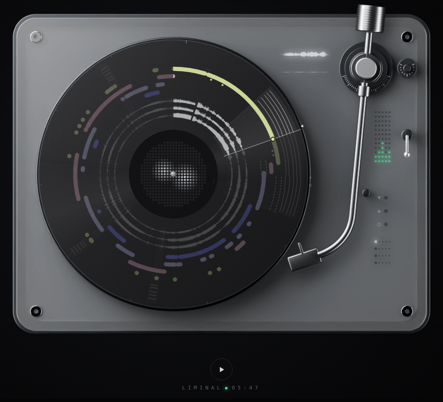

# Liminal

Creative ideas often come at the edge of sleep. People who spend a minute or so in light sleep (N1) during a short rest find hidden solutions more often than people who stay awake, and the benefit disappears once they fall into deeper sleep. The window is short and a consumer headband cannot see it directly. An answer in text cannot help with that; an agent has to act in time.

Liminal is the environment for that agent. It replays one real morning of my BrainCo EEG (04:50 to 12:50 on 11 October 2026) on a turntable:

- the record is the night: angle is time, the rings are my sleep stages and brain waves;
- the tone arm stays parked and the room stays silent until the agent steps in;
- when it does, the arm drops, the record turns and live music plays, shaped by the agent's tempo, modulation, volume and brightness;
- hover over any ring to see its name, click it to read what it is.

Status this week: the data pipeline, the Blender model and the site are built. The agent on the site is still a placeholder rule policy; the simulator core and the LLM agent are specified and come next.

[Open Liminal](../../liminal/)
